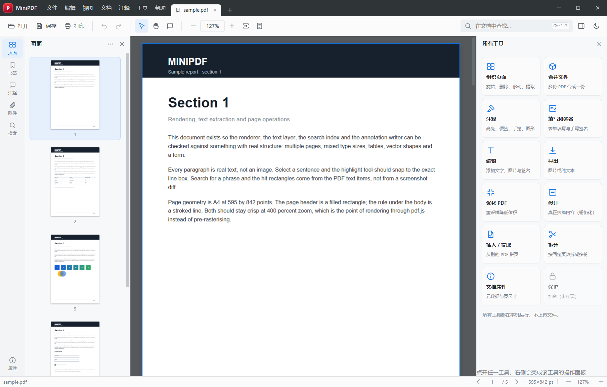
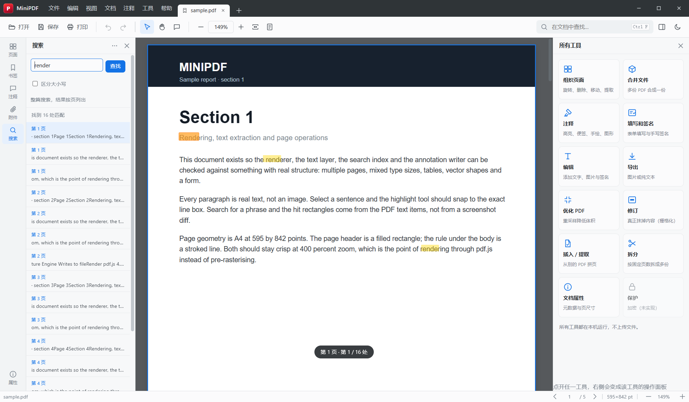
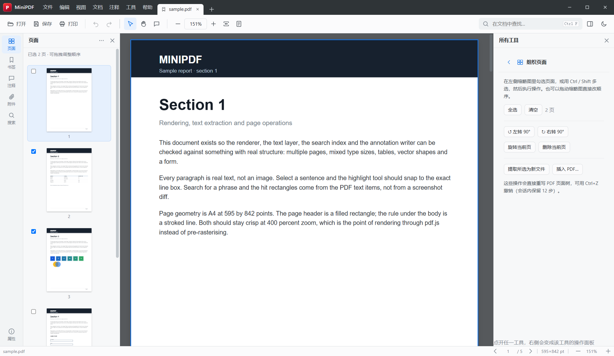
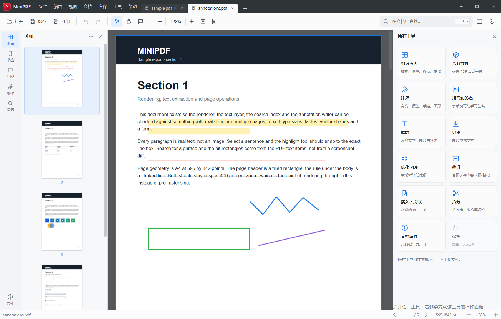
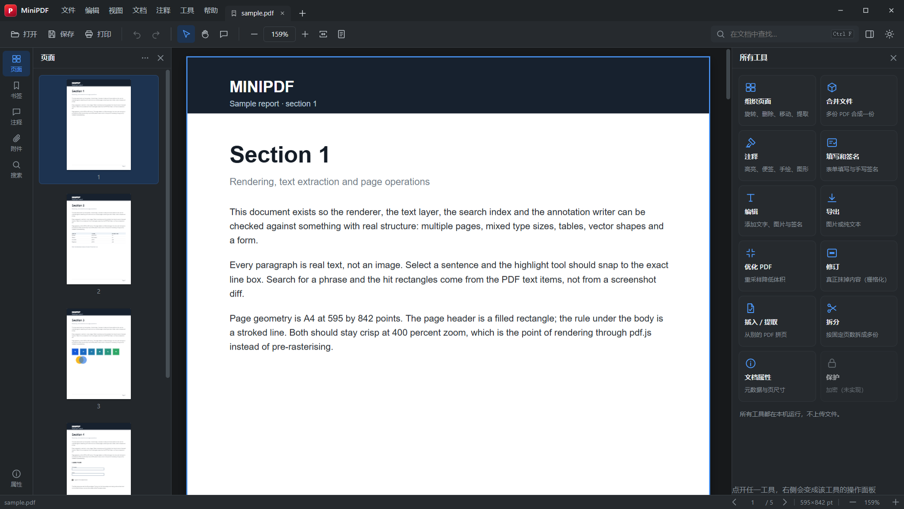
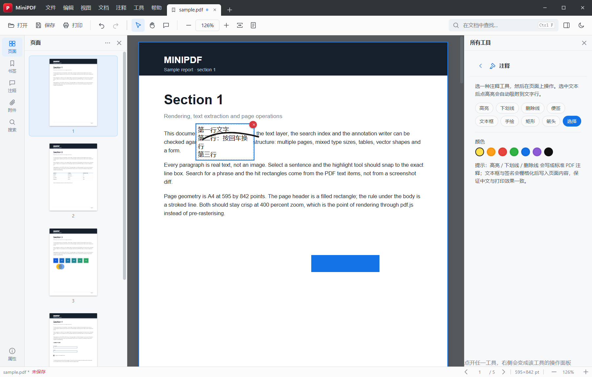

# MiniPDF 1.0.1

一个把 Acrobat 那套工作流做出来的 PDF 桌面应用：**读、搜、注释、填表、签名、编排页面、真修订**。
界面是 Electron + pdf.js 渲染 + pdf-lib 写回，所有处理在本机完成，文件不上传。



| 整篇搜索（命中来自文本项） | 组织页面（缩略图拖动排序） |
|---|---|
|  |  |

| 注释写进文件后重开 | 深色主题 |
|---|---|
|  |  |

编辑：文本框（白底盖原文）、签名、图片按原比例放置 —— 保存后即写进页面内容流。



> 这是独立实现的界面/行为复刻，不使用 Adobe 任何代码、图标或资源。Acrobat 是 Adobe 的商标，
> 本项目与其无隶属关系。功能清单见下方「与原版对照」。

---

## 装与用

```bash
npm install
npm start                # 开发运行
npm run dist             # 出安装包 → dist/minipdf_1.0.1_setup.exe
```

安装包 `npm run dist` 产物约 134 MB（Electron 自带 Chromium，装完 409 MB）。
也可以直接双击 `dist/win-unpacked/MiniPDF.exe` 免安装运行。

**打开方式**：`Ctrl+O`、拖文件进窗口、命令行 `MiniPDF.exe 某文件.pdf`、或首页「最近打开」。

### 快捷键

| 操作 | 快捷键 |
|---|---|
| 打开 / 保存 / 另存为 | `Ctrl+O` / `Ctrl+S` / `Ctrl+Shift+S` |
| 打印 / 关闭标签 / 切换标签 | `Ctrl+P` / `Ctrl+W` / `Ctrl+Tab` |
| 查找（整篇） | `Ctrl+F`，回车跳到第一处，`F3` 下一处 |
| 撤销 / 重做 | `Ctrl+Z` / `Ctrl+Y` |
| 缩放 | `Ctrl+=` / `Ctrl+-` / `Ctrl+0`（100%） |
| 适合宽度 / 适合页面 | `Ctrl+2` / `Ctrl+1` |
| 旋转视图 | `Ctrl+]` |
| 微调选中注释位置 | 方向键（按住 `Shift` 每次 10pt） |
| 全屏演示 | `F11`，`Esc` 退出 |
| 选择 / 抓手 | `V` / `H` |
| 删除选中注释 | `Delete` |

---

## 与原版对照（做了什么、没做什么）

| Acrobat 的能力 | MiniPDF | 说明 |
|---|---|---|
| 打开/多标签/缩略图/书签/附件/属性 | ✅ | 书签读原文件的 outline；附件可导出 |
| 文本选择、复制、跨页搜索 | ✅ | pdf.js 文本层，命中矩形来自 text item，不是截图比对 |
| 高亮 / 下划线 / 删除线 / 便签 / 手绘 / 矩形 / 箭头 | ✅ | 写成**标准 PDF 注释**（QuadPoints / InkList / Line），别的阅读器也认 |
| 文本框 / 签名 / 图片 | ✅ | 栅格化写进页面内容流：中文不乱码、打印一致；自动换行、框高自动增长、可拖可删、图片按原比例放置 |
| 表单填写（文本/复选/单选/下拉） | ✅ | 覆盖式输入框 + 写回 AcroForm 字段 `/V` |
| 组织页面（旋转/删除/拖动排序/插入/提取） | ✅ | 重写页面树，会话内 12 步撤销 |
| 合并 / 拆分 | ✅ | 合并追加到当前文档；拆分按固定页数落盘 |
| 导出图片 / 纯文本 | ✅ | PNG 150 DPI 逐页；文本按页分段 |
| 优化（压缩） | ✅ | 逐页重采样为 JPEG 后重组，报告前后体积与省下的百分比 |
| 真修订（Redaction） | ✅ | 受影响页栅格化 + 黑框覆盖，底层文字与矢量一并消失（实测文本长度 767 → 0） |
| 打印 | ✅ | 按 PDF 点尺寸排版后交给系统打印对话框 |
| 编辑正文（重排文字） | ❌ | PDF 没有回流概念；只做覆盖式添加文字/图片 |
| 扫描与 OCR | ❌ | 没接 OCR 引擎，不假装能做 |
| 加密/权限（AES） | ❌ | pdf-lib 不提供加密写入；宁可空着，也不做假密码壳 |
| 测量工具 / 动作向导 / 比较文档 | ❌ | 未实现 |
| 已有注释的再编辑 | 部分 | 会读出来列在「注释」面板并标注「文件内」；`MiniPDF` 自己写的可删，其他程序写的不支持删除 |

### 编辑（1.0.1 修好了什么）

1.0.0 的「编辑 → 添加文本」是坏的：工具集合里漏了 `textbox`，点页面没有任何反应。
现在这条链路是通的，而且补了几处实际用起来必须有的东西：

| 行为 | 说明 |
|---|---|
| 添加文本 | 点页面上任意位置出文本框，直接打字；回车换行、长文自动折行 |
| 框高自动增长 | 文字变多/变窄，框跟着往下长，保存时不会被裁掉 |
| 盖住原文（默认开） | 保存时先铺一层白底再画字，覆盖式编辑才看得清；可在面板关掉变成透明 |
| 选中与移动 | 选择工具下点框即选中，拖动挪位置，方向键 1pt 微调，Delete 删除 |
| 改字号 / 改宽度 | 面板里改，框高重新算 |
| 图片 / 签名 | 按原始宽高比放置，不再被拉扁；签名自动裁掉四周空白 |

限制仍然存在：保存后文字变成页面里的位图，不能再改；原文若被白底盖住，只是"看不见"，并没有从内容流里删掉 —— 要真正抹除内容请用「修订」。

**这版不追求"按钮都有"，追求"点下去真改文件"**：所有写操作都落到真实 PDF 字节，不做只在界面里存一份的假编辑。

---

## 凭什么说它"能改文件"

自检不是截图对比，是把结果读回来数。`MINIPDF_SMOKE` 会跑一条脚本、打印一行 JSON、再截一张图：

```bash
MINIPDF_SCENE=savedview MINIPDF_SMOKE=build/shot.png npm start
```

| 场景 | 检查什么 | 实测结果 |
|---|---|---|
| `read` | 页数、已渲染页、文本层 span | 5 页 / 2 页可见 / 40 个 span |
| `search` | 整篇命中数 | `render` 命中 16 处，跨 5 页 |
| `select` | 选区 → 注释矩形 | 选区生成 1 条注释、4 个矩形，落盘后仍被识别 |
| `comments` | 四类注释写入 | 高亮/便签/下划线/矩形各 1 条，写回后读回 4 条 |
| `forms` | 表单字段写回 | `fullName=Ada Lovelace`，pdf.js 与 pdf-lib 两侧都读到 |
| `savedview` | 7 种注释写进 PDF 后由渲染器重画 | `Highlight/Underline/StrikeOut/Text/Ink/Square/Line` 全部识别；中文便签 UTF-16 正常 |
| `redact` | 栅格化后文字是否消失 | 第 1 页文本长度 767 → **0**，字节 10.7 KB → 89 KB（图页） |
| `move` | 拖动排序是否真改页序 | 第 1 页变为原第 3 页（`Section 2` 抬头） |
| `undo` | 注释撤销/重做 | 1 → 0 → 1 |
| `io` | IPC 真实读写 | 写 `build/io-saved.pdf`，读回 5 页，指纹变化 |
| `multi` | 多标签 | 2 个标签，激活 `annotations.pdf` |
| `edit` | 文本框：点页面→出框→输入→保存 | 建框 1 个、输入后高度 51.5pt（3 行）、退格不误删整框、图片/签名比例 4:1 与 3:1 不变形、白底比不铺白底少 557 个原文字像素 |
| `edit-clean` / `edit-saved` / `edit-zoom` | 空白区加字 → 存 → 重开 | 三行中文完整、行距 1.32 一致、300% 下清晰无裁切 |

---

## Agent 桥（沿用 REA 的 GUI 协议骨架）

应用启动时在 `127.0.0.1:7857` 起一个只读/可控的本机接口，供外部 agent 问"用户现在在看什么"、
把视线挪过去、或者写一条注释。**宿主窗口持有全部状态，桥本身无状态。**

```bash
curl http://127.0.0.1:7857/current_view
curl -X POST http://127.0.0.1:7857/command \
  -H "Content-Type: application/json" \
  -d '{"tool":"open_target","args":{"page":3}}'
curl -X POST http://127.0.0.1:7857/command \
  -H "Content-Type: application/json" \
  -d '{"tool":"annotate","args":{"page":3,"type":"note","rect":[72,600,92,620],"content":"agent 便签"}}'
```

| 工具 | 作用 |
|---|---|
| `current_view` | 返回文档名/路径/页数/脏标记/当前页/缩放/工具/面板/选中注释 |
| `open_target` | `{page, rect?, annotId?}`：滚动到目标页或矩形 |
| `set_view` | `{panel, zoom, tool, theme}`：切面板、缩放、工具、主题 |
| `annotate` | `{page, type, rect, color, content}`：写一条注释（仍需 `Ctrl+S` 落盘） |
| `propose_patch` | 只记录建议并提示，**不应用**；写操作永远要人确认 |

实测：`current_view` 返回 `sample.pdf / 5 页 / page 1`；`open_target page 3` 后 `page:3`；
`annotate` 后 `annotations:1, dirty:true`；未知工具返回可读错误「不支持的工具 nope」。
端口可用 `MINIPDF_BRIDGE_PORT` 改，`MINIPDF_NO_BRIDGE=1` 关闭。

---

## 结构

```
electron/main.cjs      窗口、内置静态服务（让 ES module / worker 同源）、IPC、打印、Agent 桥
electron/preload.cjs   contextBridge，只暴露必要方法（contextIsolation 开、nodeIntegration 关）
app/index.html         外壳结构：标题栏/工具栏/侧栏/阅读区/工具面板/状态栏
app/css/app.css        双主题（浅色 / 深色），Acrobat 风格的画布与面板层次
app/js/engine.mjs      pdf.js 封装：载入、页信息、渲染、文本层、挂件、书签、附件
app/js/viewer.mjs      页面布局、懒渲染、缩放/旋转、选区→PDF 坐标、注释图层、表单图层、搜索高亮
app/js/ops.mjs         pdf-lib 写操作：注释、表单、旋转/删除/移动/插入/提取/拆分、栅格化压缩与修订
app/js/app.mjs         状态机与全部面板/菜单/弹窗/快捷键/自检钩子
app/vendor/            pdf.js 4.10 运行资源（含 cmaps / standard_fonts）、pdf-lib 1.17 UMD
tools/make-sample.mjs  生成带表格、图形、表单的 5 页样张
tools/make-icon.mjs    纯 Node 画 PNG/ICO（无 canvas 依赖）
samples/sample.pdf     自检样张
```

**坐标约定**：注释一律存 PDF 用户空间（左下原点、未旋转页），显示时用
`viewport.convertToViewportRectangle()` 换到屏幕坐标；写回时直接给 pdf-lib。
旋转只改 `/Rotate`，注释不动，所以"转完再存"位置仍然对。

**保存策略**：注释先进应用层（可撤销），`Ctrl+S` 时用 pdf-lib 写进文件；写过的注释标记
`inFile`，不再叠加绘制（画布上已经是文件里的那份）。删除已写入的注释，会立刻从字节里摘掉
（按 `/NM` 匹配）并重绘，不会出现"列表删了、页面还在"。

---

## 开发与打包

```bash
npm run sample      # 重新生成 samples/sample.pdf
npm run serve       # 纯浏览器调试（无 IPC，仅界面/渲染）
npm start           # Electron
npm run dist        # NSIS 安装包（electron-builder）
node tools/make-icon.mjs   # 重画图标
```

打包机注意：

- 环境里有 `ELECTRON_RUN_AS_NODE=1` 时 electron 会被当纯 Node 跑，启动前 `env -u ELECTRON_RUN_AS_NODE`；
- 本机 `NODE_OPTIONS` 里的 safe-delete shim 会让 electron-builder 清目录时 EPERM，打包要 `env -u NODE_OPTIONS`；
- 路径含中文时 electron-builder 仍按 UTF-8 处理，但不要把输出目录放到网络盘。

---

## 踩过的坑（都是实测撞出来的）

- **pdf.js 会 detach 传入的 `data`**：把同一个 `Uint8Array` 既留作原文件又交给 `getDocument`，
  第二次保存会得到空 buffer。载入前必须 `new Uint8Array(bytes)` 复制一份。
- **同一 canvas 不能并发 render**：`IntersectionObserver` 与 `renderVisible()` 会同时触发同一页，
  直接报 `Cannot use the same canvas during multiple render() operations`。要 per-page 加锁 +
  取消上一个 `RenderTask`，并记录 `scale:rotation` 作为缓存键。
- **pdf-lib 压缩后类名不可靠**：`f.constructor.name === 'PDFTextField'` 在 UMD 压缩产物里不成立，
  表单写入会静默失效。要用 `instanceof PDFTextField`。
- **`context.obj()` 把字符串变成 PDFName**：`Contents: ''` 会写成空名字对象；空内容必须用
  `PDFHexString.fromText('')` 或不写。`PDFHexString.fromText` 才能正确存中文。
- **flex 居中会吃掉溢出部分**：200% 缩放时 `align-items:center` 让页面左边缘滚不到。改成
  `align-items:flex-start` + `.page{margin:0 auto}`，"装得下居中、装不下从左开始"。
- **高 DPI 下窗口尺寸会自己长大**：`getContentBounds()` 有 ±9px 取整误差，反复"读回来再写回去"
  每次多几像素，几分钟后窗口比屏幕还宽。只恢复位置，不恢复尺寸。
- **TextLayer 需要 `--scale-factor`**：不设这个 CSS 变量，文字层会按 1:1 铺在放大后的画布上，
  选区错位到页面外。
- **工具 id 和绘制集合不是一回事**：面板里叫 `textbox`，绘制分派里只写了 `freetext`，
  于是"选工具→点页面"这一步被 `DRAW_TOOLS.has()` 静默拦掉，按钮亮着但画不出来。
  UI 用的 id 必须和工具集合里的键完全一致。
- **contenteditable 的换行不在 `textContent` 里**：按回车生成 `<div>`/`<br>`，
  `textContent` 会把两行粘成一行，存进去的字少了换行。要自己遍历节点把块级元素还原成 `\n`。
- **选中框之后退格会删掉整个框**：外层 keydown 监听 `Backspace` 删注释，
  而文本框里打字的事件会冒泡上去。必须判断 `e.target.isContentEditable` 直接返回。
- **`renderAnnotations()` 会重建 DOM**：点一下文本框就重绘，等于把刚拿到的焦点丢掉，
  导致"点进去输不了字"。选中态改成只切 class、不重建节点。
- **`window.getSelection().toString()` 在 pdf.js 文本层里可能是空串**，但 `getClientRects()`
  有值；高亮按矩形做，不依赖字符串。

---

## 还没做的，以及为什么

| 能力 | 状态 | 原因 |
|---|---|---|
| 加密 / 权限 | 未实现 | pdf-lib 不支持 AES 写入；不做假密码框 |
| OCR | 未实现 | 需要 tesseract 之类的引擎与语言包，本版不塞半个进去 |
| 正文重排编辑 | 未实现 | PDF 是绘图指令不是流式文本；只做覆盖式添加 |
| 外部注释删除 | 不支持 | 其他程序写的注释没有 `/NM`，无法安全定位；界面会明确提示 |
| 双页/连续对开 | 未实现 | 单页连续滚动已覆盖主要阅读场景 |
| 文件关联 | 未做 | 安装器不抢 `.pdf` 默认程序；可用「打开方式」选择 MiniPDF |

---

## 依赖与许可

- [pdf.js](https://github.com/mozilla/pdf.js) 4.10 — Apache-2.0，负责渲染与文本层
- [pdf-lib](https://github.com/Hopding/pdf-lib) 1.17 — MIT，负责写回
- Electron 45 / Chromium — MIT

本仓库代码为独立实现；不含 Adobe 的可执行代码、图标或字体。
